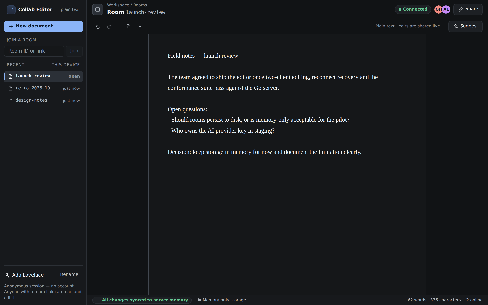
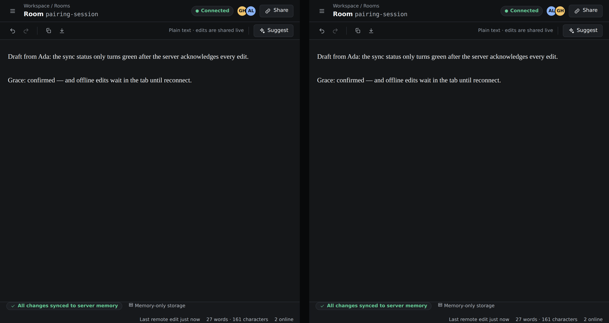
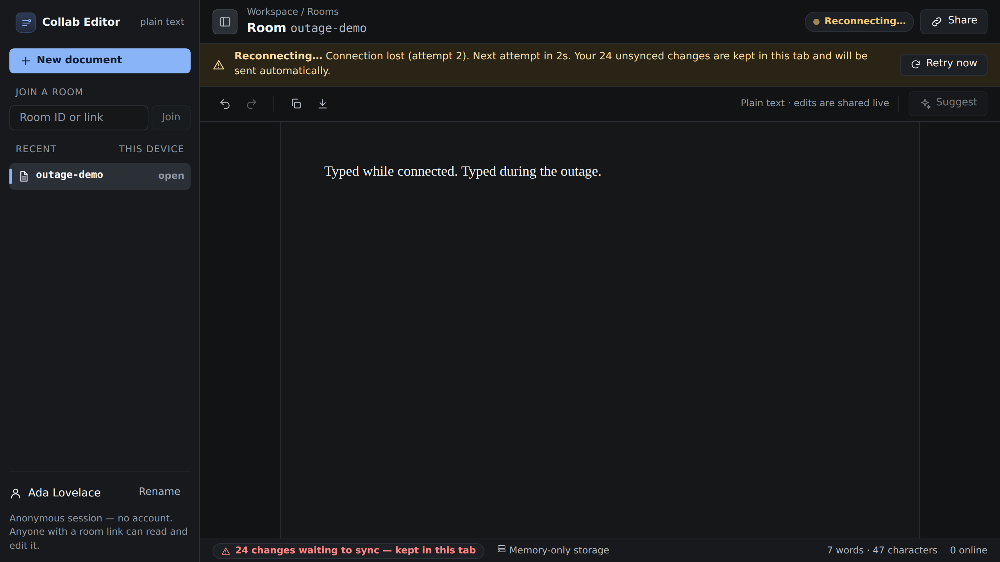
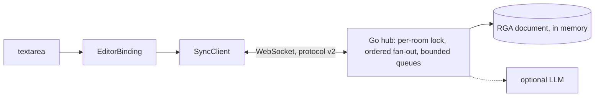

# Collab Editor

[](https://github.com/KartikaySrivastava258/collab-editor/actions/workflows/ci.yml)
[](LICENSE)

A real-time collaborative plain-text editor: a Go WebSocket server and a React client that merge
concurrent edits with an RGA sequence CRDT, keep working through disconnects, and report sync state
truthfully.



<sub>All screenshots are generated from real browser sessions by `frontend/bench/capture-screenshots.mjs`.</sub>

## Project status

| Area | State |
|---|---|
| CRDT, sync client, editor, UI | 47 unit/property tests, 28 protocol conformance tests, 31 Chromium end-to-end tests |
| Go server | Stdlib-only WebSocket layer, per-room ordering, backpressure, presence, opt-in AI; 50 Go test/fuzz functions, and CI runs the same protocol and browser suites against the Go binary |
| Persistence | **Memory only** for now. See [limitations](docs/KNOWN_LIMITATIONS.md). |
| Auth | **None.** Anyone with a room link can edit. |

## Features (each covered by tests)

- **Conflict-free concurrent editing.** An RGA CRDT with unique `(client, Lamport)` IDs. Replicas
  converge regardless of delivery order, duplicates or late joins (property-tested against an
  independent oracle; Go and TS implementations share 45 cross-language test vectors).
- **Offline-tolerant sync.** Edits are queued until acknowledged. Reconnect uses jittered
  exponential backoff plus a heartbeat, and re-sends only what the server is missing. After a
  server restart, connected clients restore the room.
- **Correct text input.** Typing over selections, paste, IME composition, emoji and non-BMP text,
  and a caret anchored to characters (not offsets) while others edit.
- **Undo/redo of your own edits only**, expressed as CRDT operations.
- **Truthful UI.** The connection state, real presence, "synced" only after a server ack,
  memory-only storage clearly labelled, and AI disabled with a stated reason when not configured.
- **Optional AI suggestions** (OpenAI-compatible): private to the requester, inserted only on
  request, with cancellation, timeout and provider errors surfaced.
- **Dark, responsive, accessible shell.** Sidebar/drawer, keyboard-reachable controls, focus
  management, reduced motion, WCAG AA text contrast.

<table><tr>
<td></td>
</tr><tr>
<td></td>
</tr></table>

More: [reconnected](docs/screenshots/03b-reconnected.png) · [mobile (editor + drawer)](docs/screenshots/04-mobile.png) · [test results](docs/screenshots/05-test-results.png) · [AI suggestion panel (mock provider)](docs/screenshots/06-ai-suggestion.png)

## Architecture



| Layer | Tech | Purpose |
|---|---|---|
| Server | Go 1.22, stdlib only | WebSocket (RFC 6455, size-bounded), rooms, validation, presence, AI calls, static files |
| CRDT | Go + TypeScript | Same RGA algorithm on both sides, checked by shared vectors |
| Client | React 19, TypeScript, esbuild | UI shell; framework-free `SyncClient` and `EditorBinding` |
| Tests | node:test, Playwright 1.56, Go testing/fuzz | Unit, property, conformance, browser E2E |

Details: [Architecture](docs/ARCHITECTURE.md) · [Protocol](docs/PROTOCOL.md) · [What was broken and how it was fixed](docs/DIAGNOSIS.md)

## Quick start

**Docker** (one image serves the frontend, API and WebSocket):

```bash
docker compose up --build        # → http://localhost:8080
```

**Local** (Go 1.22+, Node ≥ 22.18):

```bash
git clone https://github.com/KartikaySrivastava258/collab-editor.git
cd collab-editor
make install                     # npm install in frontend/ (Go has no third-party modules)
make dev                         # Go server :8080 + frontend dev server :3000 → http://localhost:3000
# or a production-style single origin:
make build && STATIC_DIR=frontend/dist ./backend/bin/collab-editor-server   # → http://localhost:8080
```

**Without Go** (protocol test server, for trying the UI only):

```bash
cd frontend && npm install && npm run build && STATIC_DIR=dist npm run test-server   # → http://localhost:8080
```

Then follow the [user guide](docs/USER_GUIDE.md): **New document** → **Share** → open the link in
a second browser.

## Configuration

All optional; see [`.env.example`](.env.example). Invalid values stop the server at startup with an
explanation.

| Variable | Default | Meaning |
|---|---|---|
| `PORT` | `8080` | HTTP port |
| `ALLOWED_ORIGINS` | `http://localhost:3000,http://127.0.0.1:3000` | Browser origins allowed besides same-origin |
| `STATIC_DIR` | *(empty)* | Serve the built frontend from this directory |
| `MAX_DOC_ATOMS` / `MAX_ROOMS` / `MAX_CLIENTS_PER_ROOM` / `MAX_MESSAGE_BYTES` | 200000 / 100 / 50 / 262144 | Resource limits (atoms include deleted characters) |
| `LLM_API_KEY`, `LLM_MODEL`, `LLM_API_URL`, `AI_TIMEOUT_MS` | off | Optional AI; the model is required when a key is set |
| `SHUTDOWN_TIMEOUT_MS`, `LOG_FORMAT` | 10000, `json` | Lifecycle and logging |
| `COLLAB_WS_URL` | dev: `ws://localhost:8080/ws`; prod: same origin | Frontend build-time WebSocket URL |

Endpoints: `/ws`, `/health`, `/healthz`, `/readyz`, `/api/room/text?roomId=` ([protocol](docs/PROTOCOL.md)).

## Tests

```bash
make test           # Go + frontend unit + protocol conformance + Playwright E2E (TS test server)
make test-race fuzz # Go race detector + 30 s fuzz
make test-protocol-go test-e2e-go   # same conformance + browser suites against the Go server
```

See [TESTING.md](docs/TESTING.md) for what each layer covers and how the suites were
mutation-checked.

## Measured results

From [BENCHMARKS.md](docs/BENCHMARKS.md): 1-vCPU Linux VM, Node 22.22.2, Chromium 141 headless.
Network numbers were measured on loopback against the TypeScript protocol server; `make bench-go`
runs the same workload against the Go binary.

| Metric | Result |
|---|---|
| Convergence, original CRDT vs. RGA (500 seeded runs, 3 replicas) | **1/500 → 500/500** |
| Single-writer edits landing at the intended position (500 runs) | **5/500 → 500/500** |
| Remote edit latency, sender → receiver (n = 1,000) | p50 0.38 ms · p95 0.83 ms · p99 2.40 ms |
| Browser-to-browser keystroke visibility (n = 200, ~1 frame resolution) | p50 15 ms · p95 20 ms · p99 27 ms |
| Reconnect → all edits acked, excluding backoff (n = 20) | p50 4.7 ms · p95 13.2 ms |
| 10-client room, 10 s load | 36,860 ops, 0 lost, 0 disconnects, all replicas identical (3,679 ops/s, load-generator bound) |
| Keystroke handler, 100k-char document (profile-guided fix) | p99 **34.7 → 5.3 ms**, p50 8.4 → 1.7 ms |
| JS / CSS bundle (gzip) | 73.3 KiB / 3.6 KiB |

## Design choices and tradeoffs

- **RGA instead of fractional indices.** No precision exhaustion, provable convergence. Costs:
  tombstones are kept (bounded by `MAX_DOC_ATOMS`), and order among concurrent runs is by ID.
- **Textarea plus diffing instead of `contentEditable` or a rich-text framework.** Honest plain-text
  scope, native IME, selection and accessibility, and one code path for every kind of input.
- **Server validates whole batches atomically**, and clients roll back on rejection, so replicas
  never silently diverge.
- **Memory-only server with client-side restoration.** Simple to operate. Not durable without a
  connected client.
- **Stdlib WebSocket.** Zero Go dependencies, hardened and tested, but a maintained library is the
  recommended next step.

## Security and privacy

No accounts or authorization: room links are bearer access. The server provides origin
allowlisting, strict input validation, size and rate limits, a CSP for static files, a non-root
distroless image, and logs without document text, prompts or keys. TLS should be terminated by a
reverse proxy. There is no end-to-end encryption.

## Roadmap

**Implemented:** everything under Features. **Planned / not implemented:** durable storage (op log
plus snapshots), authentication and per-room permissions, tombstone compaction, remote
cursors/selections, a maintained WebSocket library, an axe/screen-reader audit, and multi-instance
scaling. See [KNOWN_LIMITATIONS.md](docs/KNOWN_LIMITATIONS.md).

## Repository layout

```
backend/    Go server: ws/, hub/, crdt/ (+ testdata/vectors.json), api/, ai/, config/, main.go
frontend/   React app (src/), TS test server (test-server/), protocol suite (tests/), Playwright (e2e/), bench/
scripts/benchmarks/   CRDT and WebSocket benchmarks, baseline copy of the original CRDT, results/
docs/       ARCHITECTURE, PROTOCOL, DIAGNOSIS, TESTING, BENCHMARKS, KNOWN_LIMITATIONS, USER_GUIDE, screenshots/, test-logs/
```

## License

MIT, see [LICENSE](LICENSE). Contributions: open an issue or PR; please run `make test` (and the Go
suites) before submitting.
