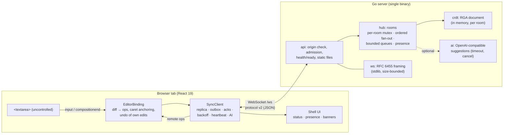

# Architecture

## Components

| Path | Responsibility |
|---|---|
| `frontend/src/crdt/rga.ts` | RGA sequence CRDT (shared by the browser, the TS test server and the tests) |
| `frontend/src/editor/textDiff.ts` | Turns any textarea change into one surrogate-safe edit |
| `frontend/src/editor/EditorBinding.ts` | Textarea ↔ CRDT: local ops, remote rendering, caret anchoring, IME deferral, undo |
| `frontend/src/editor/history.ts` | Undo/redo of this client's own edits, expressed as CRDT ops |
| `frontend/src/sync/SyncClient.ts` | Connection state machine, outbox/acks, reconnect, recovery, AI requests |
| `frontend/src/ui/*`, `App.tsx` | Shell: sidebar, header, toolbar, canvas, status bar, toasts, dialog |
| `backend/crdt` | Go port of the RGA CRDT; checked against `testdata/vectors.json` generated from TS |
| `backend/ws` | WebSocket framing on the standard library (plus a small client used by tests) |
| `backend/hub` | Rooms, clients, validation, fan-out, backpressure, AI dispatch |
| `backend/api`, `backend/config`, `backend/ai`, `main.go` | HTTP surface, fail-fast config, LLM client, lifecycle |
| `frontend/test-server` | Same protocol in TypeScript: lets the protocol and E2E suites run without Go. **Not** a production backend. |

## The CRDT (RGA)

Each character is an atom with an ID `(c, t)`: client ID and Lamport counter. An insert records
the atom it was typed after (`o`). Concurrent inserts after the same origin are ordered by
descending ID, and integration skips atoms whose ID is greater than the new one's. Because every
insert has `t > t(origin)` (validated), any atom after the origin with a greater ID belongs to a
subtree that must precede the new atom. Every replica therefore produces the same pre-order
traversal of the insertion tree, regardless of delivery order. The randomized property test
checks this against an independent tree-traversal oracle.

**Tradeoffs**
- *Interleaving.* Concurrent typing runs at the same spot stay contiguous (each run's characters
  chain off each other), but which run comes first depends on IDs, not timing. Backward-typing
  anomalies known from the RGA literature are possible; newer algorithms (Fugue/YATA) avoid them
  at more complexity.
- *Tombstones* are kept forever (no garbage collection). Memory is bounded by `MAX_DOC_ATOMS`,
  which counts tombstones; see KNOWN_LIMITATIONS.
- *Positions are Unicode code points.* A grapheme cluster (e.g. 👩‍👩‍👧) spans several atoms, so
  concurrent edits *inside* one cluster can split it visually. Code points themselves are never
  split, and lone surrogates are replaced with U+FFFD.
- *Lookup cost.* Locating an origin is O(n) in the worst case, with a "last insert" hint that
  makes sequential typing O(1). Measured cost is in BENCHMARKS.md.

## Ordering and concurrency in the server

- `Hub.mu` guards the room map, and `Room.mu` guards one document plus its clients. The lock order
  is always hub → room.
- A batch is validated, applied, fanned out and acknowledged while holding `Room.mu`. Every client
  therefore sees one total order, and a joiner's welcome snapshot is queued before any later op.
- Each client has a bounded queue (256 messages) and one writer goroutine. A full queue
  disconnects that client (4002) instead of blocking the room; it resyncs on reconnect.
- Channels are never closed. Shutdown uses `done` plus `sync.Once`, which removes the original
  "send on closed channel" panic.

## Persistence and security model (honest boundaries)

- **Storage is memory only.** Rooms live in the server process. If the server restarts, a room
  survives only if a connected client reconnects: it notices the new `epoch` and replays its copy
  via `sync` (tested end to end in `SyncClient.test.ts`). With no client connected the content is
  lost. The UI says "server memory" and never "saved".
- **No authentication or authorization.** Anyone who knows a room ID can read and edit it. Room
  IDs are random 8-character strings from a CSPRNG when created via "New document", but they are
  **not** a security mechanism. Author IDs are not authenticated.
- Origin allowlisting (CSWSH protection), input validation, size and rate limits, CSP and
  `nosniff` on static files.
- Logs are structured (`slog` JSON) and contain no document text, prompts or keys.
- No TLS in the binary: terminate TLS at a reverse proxy (the client uses `wss://` automatically
  on HTTPS pages).

## Build and deployment

- **Production.** One distroless, non-root image. The Go binary serves the API, the WebSocket and
  the built frontend from one origin, so share links and sockets agree. `HEALTHCHECK` uses the
  binary's own `healthcheck` subcommand (the image has no shell).
- **Development.** `make backend` (:8080) plus `make frontend` (esbuild dev server on :3000 with
  live reload).
- **Frontend tooling.** esbuild instead of the deprecated react-scripts: two small scripts
  (`scripts/build.mjs`, `scripts/dev.mjs`), fast builds, and a far smaller dependency tree.
